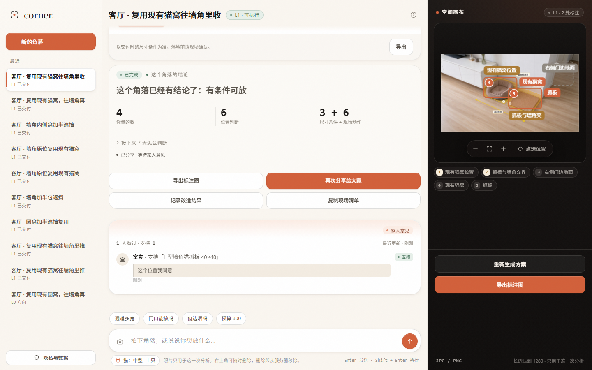
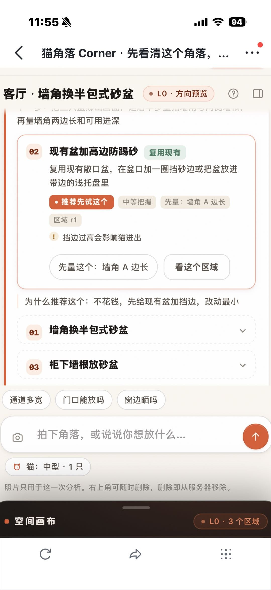
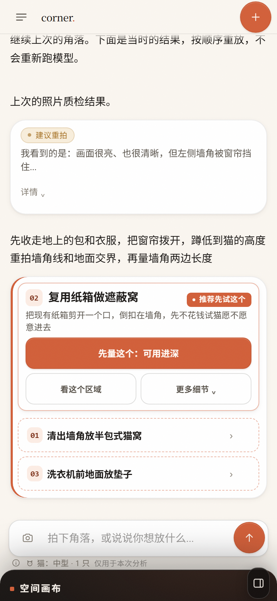

# 猫角落 Corner

> **买前的位置检查。** 拍下家里一个角落，先回答「**这个位置，猫会不会用？**」，再回答「**放不放得下？**」
> 两个都通过，才给你一份能带去店里的方案——每条结论都挂可核查的依据，每个不确定都写明还要量什么，
> 并且始终保留「什么都不买」的选项。

零依赖（无 npm 包、无框架、无打包器），前端原生 ES module，服务端只用 `node:*`，
AI 是 DeepSeek 多模态（`deepseek-flash`，支持图片输入）。

<!-- V2：三个承诺 -->
| 承诺 | 怎么做到 |
|---|---|
| **位置先于尺寸** | 交付包第一个 tab 是「位置」：能藏 / 资源分隔 / 砂盆条件 / 抓挠位置 / 高处 / 温度日照，6 项逐条判定 |
| **依据可核查** | 每条判断挂 `basisId` → `GET /api/evidence`（29 条，含作者、年份、期刊、URL、证据强度），界面标「研究支持 / 专家共识 / 经验值」 |
| **不知道就说不知道** | 照片看不出的（噪音源、体长、猫性格）标 `unknown` 或 `na`，绝不因为没有"发现问题"就算通过 |

---

## 一次闭环之后会发生什么（V3）

普通 AI 产品在给出方案的那一秒就结束了。这个产品在那一秒之后才开始收束：

**1. 收尾卡**——明确告诉你这件事已经有结论了：

```
已完成 · 这个角落的结论
这个角落已经有结论了：有条件可放
  3        6              3 + 6
你量的数  位置判断   尺寸条件 + 现场动作
接下来 7 天怎么判断（可展开）
[导出标注图] [分享给同住的人] [记录改造结果] [复制现场清单]
```

**2. 分享给同住的人**——社交单元是「住在一起的人」，不是公开社区（Muse 的社交是把这一刻变成可流转的卡片，不是发到广场）：
- 生成 `/s/<token>` 只读分享页：结论、位置 6 项、尺寸三态条件、方案，**不含**你的输入记录/点选/画像
- 链接 **24 小时过期、可随时撤销**，**服务端按连接来源只放行局域网**（非私网 `403`）；图片是客户端生成的 **900px 缩略图（约 57KB），没有缩略图就 404，绝不回落原图**
- 家人不用登录，点「支持 / 犹豫 / 反对」+ 一句话留言（匿名显示为「家人 N」）
- **有回执才算闭环**：你切回应用时，会收到 `家人给了意见 · 支持 1 · 犹豫 0` 的提示，交付卡下方出现「家人意见」卡（支持/犹豫/反对 + 昵称 + 留言 + 相对时间 + 未读角标），滚到卡片即自动已读，刷新不会重复打扰

<!-- 社交闭环证据 -->


**3. 记录改造结果**——上传改造后的照片，生成**改造前 / 改造后对比卡**，可编辑一句总结、可导出对比 PNG。

**4. 装到手机主屏**——`manifest.webmanifest` + maskable 图标，iOS/Android 都能「添加到主屏幕」，全屏打开像原生应用。

---

## 演示视频（真实录制）

| 视频 | 尺寸 | 时长 | 内容 |
|---|---|---|---|
| [corner-demo-phone.mp4](docs/demo/corner-demo-phone.mp4) | 390×844 竖屏 | ~109s | **主推**：手机端完整旅程（含全屏标注查看器） |
| [corner-demo-desktop.mp4](docs/demo/corner-demo-desktop.mp4) | 1440×900 | ~92s | 桌面三栏版 |

真实 DeepSeek + 真实家庭照片 + 真实分享投票，不是剪辑合成。逐段说明见 [docs/demo/README.md](docs/demo/README.md)；
重新录制：`node --experimental-websocket scripts/make-demo-video.mjs --w=390 --h=844 --out=docs/demo/corner-demo-phone.mp4`。

## 跑起来

```powershell
cd D:\OneProject
node app/server/index.mjs
```

启动后终端会打印两个地址：

```
本机     http://127.0.0.1:8848
局域网   http://192.168.1.5:8848   （WLAN）
```

- Node ≥ 20（实测 v20.20.1）
- 首次运行前确认 `app/.env` 里 `DEEPSEEK_API_KEY` 已填
- 端口被占用时：`$env:PORT=8849; node app/server/index.mjs`
- 也可双击 `run.cmd`（会自动用能命中防火墙规则的 node 启动）

### 手机端（真机尺寸实测，不是"缩到 390 看看"）

用真实家庭照片 + CDP 真实设备仿真（`scripts`/`.scratch/mobile-audit.mjs`）量出来的数字：

| 指标 | 改造前 | 现在（390×844） | 360×800 | 412×915 |
|---|---|---|---|---|
| 输入区 composer | **161px（19%）** | **74px** | 74 | 74 |
| 内容区 feed | 63% | **80%** | 79% | 82% |
| 照片质检卡 | 423px | **133px（折叠）** | 133 | 114 |
| 推荐方向卡 | **788px（比内容区还高）** | **313px** | 313 | 259 |
| 首屏主操作 | ❌ 看不到 | ✅「先量这个」318×44 | ✅ 288×44 | ✅ 5 tab + 导出 |
| 触控 <40px | 1 个 | **0** | 0 | 0 |

具体做了：顶栏收成 48px（☰ 会话 + corner. + ＋）；chips 只在欢迎态显示、猫档案与隐私说明压成一行（欢迎态因多一行 chips，composer 约 106px，进入会话后收到 74px）；照片质检卡默认折叠成「我看到的是…」+ 详情；方向卡一屏一卡（标题+推荐徽章同行、描述 2 行、全宽主 CTA、其它收进「更多细节」）；其它方向折叠成 48px 单行；L0/测量卡渲染后自动把主操作滚进首屏。

<!-- 手机端：改造前 vs 改造后 -->
| 改造前（用户真机截图） | 改造后（390×844 实测） |
|---|---|
|  |  |

### 让同一 Wi-Fi 的手机 / 平板访问

1. 双击 `run.cmd`，或按上面命令启动；
2. 手机连**同一个 Wi-Fi**，浏览器打开终端打印的「局域网」地址（如 `http://192.168.1.5:8848`）；
3. 打不开的话，说明这台机器没有放行该端口的入站连接：
   右键 **`scripts/open-lan-firewall.cmd` → 以管理员身份运行**（只加一条 TCP 8848 入站规则）。
   当前机器上 `D:\nvm\v20.20.1\node.exe` 已有 Public 网络的入站放行规则，所以用 `run.cmd` 启动通常无需改防火墙。

注意事项：

- **局域网访问是开放的**：同一网络内任何人都能打开并消耗你的 API 额度。只在家/可信网络用。
- 想关掉：把 `app/.env` 里的 `HOST` 改成 `127.0.0.1` 再重启。
- 手机端上传照片用系统文件选择（不需要 HTTPS）；若日后要接摄像头实时画面才需要 HTTPS。
- 多台设备共用同一份会话数据（没有账号体系），所以家人之间会看到彼此的角落档案。

### 试一遍完整流程

1. 点「＋ 新的角落」→ 上传一张室内角落照片（可直接用 `app/public/demo/corner.jpg`）
2. 看质检结果 → 得到 **L0 方向预览**（免费段，只判断"值不值得继续"）
3. 按测量卡填 1—2 个尺寸（一卡一项，可跳过，也可「估个范围」）
4. 点「生成可执行方案」→ 演示解锁（不真实扣款）→ 拿 **L1 交付包**（位置 / 尺寸条件 / 建议 / 清单）
5. 右侧画布可「点选位置」追问；交付包可导出标注图 PNG、可「改一改」重算

快捷命令（输入框）：`/重拍`、`/重来`、`/导出`。

---

## 目录

```
app/
  .env                     DEEPSEEK_API_KEY / 模型 / 端口（不进前端）
  server/
    index.mjs              HTTP 服务：静态资源 + 路由 + SSE
    deepseek.mjs           流式 chat/completions 客户端（含 JSON 修补、参数降级重试）
    store.mjs              会话与图片落盘（磁盘即数据库，原子写）
    config.mjs             .env 解析与常量
    prompts.mjs            五阶段提示词 + normalize（结构补强校验）
    rules.mjs              确定性规则：测量字典 / SKU / catFit 六项 / 预算与阻断 / 证据挂载
    evidence.mjs           证据目录加载器（热更新，按 mtime 缓存）
    data/skus.json         猫用品候选库（14 个）
    data/evidence.json     证据目录（29 条：作者/年份/期刊/URL/强度/caveat）
  public/
    index.html             主应用外壳（rail / 会话流 / 空间画布）
    share.html             家庭分享页 /s/<token>（只读，独立入口）
    manifest.webmanifest   PWA：可添加到手机主屏幕
    icons/                 192 / 512 / maskable / apple-touch-icon
    styles/                base / components / screens / share
    js/                    api / state / image-utils / feed / cards / canvas / flow / app / share
    demo/                  演示照片
  data/                    运行时会话、上传图、分享（自动生成，可随时删）
doc/                       产品纲领与概念图
docs/
  RESEARCH-CAT.md          猫行为学证据库（30 条证据 + 23 条可编码规则 + 8 条「必须承认不知道」）
  RESEARCH-PSYCH.md        决策心理学证据库（28 条 + 24 条设计动作 + 9 条拒绝清单 + 实验设计）
  PRODUCT-V2.md            证据驱动的产品定义（位置先于尺寸 / 依据可核查 / 反操纵承诺）
  CONTRACT.md              V1 接口契约
  CONTRACT-V2.md           V2 增补契约（catFit / evidence / na / warn 四态 / 区间估计）
  CONTRACT-V3.md           V3 增补契约（share / vote / after / 收尾卡 / 手机端清单）
  DESIGN.md                设计取舍：向千问/豆包/Meta Muse 学了什么，创新在哪
  AI-LOGIC.md              提示词设计与实测（五阶段 + A/B + 证据挂载规则）
  QA-REPORT.md             V1 独立验收报告
  QA-REPORT-V2.md          V2 独立验收报告（677+100 项断言，最终 PASS）
  QA-REPORT-V3.md          V3 独立验收报告
  UI-CLASSES.md            设计系统 class 清单与卡片 DOM 约定
  screens/                 交付截图（欢迎态 / 测量 / 位置 tab / 手机 / 依据弹层 / 平板 / 分享页）
scripts/
  test-ai.mjs              五阶段真实 API 回归（66 条断言组）
  build-evidence.mjs       从 RESEARCH-CAT.md 编译证据目录
  build-icons.ps1          PWA 图标生成（System.Drawing）
  open-lan-firewall.cmd    备用：放行局域网 TCP 8848
tests/                     独立验收脚本（DOM / V1+V2+V3 端到端 / 截图 / CDP 诊断）
```

## 交付截图

| 文件 | 说明 |
|---|---|
| `docs/screens/01-welcome-1440.png` | 欢迎态：三句承诺 + 真实示例卡 + 「不买也行」 |
| `docs/screens/02-measure-1440.png` | 测量/交付流程中的真实一屏 |
| `docs/screens/03-delivery-1440.png` | L1 交付包「位置」tab：6 项判断 + 依据徽章 + 归属感行 |
| `docs/screens/04-mobile-390.png` | 手机 390×844（CDP 真实设备模拟） |
| `docs/screens/05-basis-popover-1440.png` | 点依据徽章：claim + 来源 + 链接 + caveat |
| `docs/screens/05-tablet-1024.png` | 平板断点 900—1179px |

## 不做的事（反操纵承诺）

假社会证据 / 倒计时与虚假稀缺 / 假精确置信度（「87% 能放下」）/ 损失框架恐吓（「再不改猫会抑郁」）/
confirmshaming / 预勾选附加项与 drip pricing —— 每条都有研究或法规依据，详见 [RESEARCH-PSYCH.md](docs/RESEARCH-PSYCH.md) §3
与 [PRODUCT-V2.md](docs/PRODUCT-V2.md) §4。
```

## 这个产品的判断依据从哪来

不是「感觉像」，而是两份证据库（都在 `docs/`）：

- **猫的行为学证据**：[RESEARCH-CAT.md](docs/RESEARCH-CAT.md) —— 30 条证据 + 23 条可编码规则。
  强度诚实分级：强 2 / 中 6 / 弱 5 / 仅专家共识 17（这个领域本身就以专家共识为主）。
  关键结论：猫等热区 **30–38 ℃**（所以 20–22 ℃ 室温对猫偏冷）；抓板**放在猫常活动处**比放墙角更有效（n=1211）；
  「砂盆数 = 猫数+1」原文自称经验法则、横断面数据甚至反向相关；**「60cm 通道」查无实据**。
- **人的决策心理学证据**：[RESEARCH-PSYCH.md](docs/RESEARCH-PSYCH.md) —— 28 条证据 + 24 条设计动作 + 9 条拒绝清单。
  关键结论：实施意图（if-then）d=0.65；起步赠进度 34% vs 19%；IKEA 效应**以"能完成"为前提**（未完成会贬值）；
  预防类行为收益框架略优、损失框架无效（所以不做恐吓）；蔡格尼克记忆优势**复现失败**（所以不做愧疚驱动）。

合成结论见 [PRODUCT-V2.md](docs/PRODUCT-V2.md)：**位置先于尺寸，依据可核查，不知道就说不知道。**
产品里每一条判断都挂到证据目录（`GET /api/evidence`，27 条），界面上标「研究支持（强/中）/ 专家共识 / 经验值」三种徽章。

## 实测指标（2026-10-24，真实 API，非 mock）

| 环节 | 耗时 | 说明 |
|---|---|---|
| 照片质检 quality | 2.2—5.2s | 返回是否可用 + 具体补拍建议（坏照片会判 retake） |
| L0 方向预览 | 3.9—5.8s | 具体指认 + 专业边界句 + 2—3 个方向（至少 1 个不花钱）+ 照片环境读数 |
| 测量一轮 measure | 0.8—2.2s | 一卡一项；3 轮内必然收敛 |
| **L1 交付包 plan** | **3.7—6.6s** | 含位置 6 项判断、行为预测、观察清单、if-then；关闭思考换取速度 |
| 全流程（上传→L1） | ≈ 20—25s | 含 0.9s 演示解锁 |

- measure **收敛保证**：目标集合 = 3 个关键地面尺寸 + 当前方向第一步 + L0 缺失项；全部测过（含跳过）就返回空题，`measureDone=true`
- 区间估计：可以「估个范围」，系统按**保守端**计算并标注「按 55cm 保守估算」
- 关键尺寸缺失时 `plan.verdict` 必定降级（`insufficient` / `not_supported`），headline 同步改写且**不得含肯定语义**
- 全程 `repaired:0`（没有触发 JSON 自修复），无输出截断

## 技术决定（为什么这么选）

| 决定 | 理由 |
|---|---|
| 零依赖 Node 服务端 | 用户机器上 `node 一个文件` 就能跑，不受 npm 网络/版本地狱影响；也方便日后塞进任何运行时 |
| 原生 ES module 前端 | 没有构建步骤 = 改完刷新即生效；MVP 阶段的可读性比工程化更重要 |
| 服务端持有 API Key | Key 不进浏览器；同时服务端可以做"模型输出 → 结构校验 → 确定性规则"的兜底，前端只吃结构化结果 |
| SSE 流式 + 结构化 JSON | 用户看得到"正在想"，但界面吃的是结构化卡片而不是一坨文字（豆包/千问的做法）|
| 磁盘 JSON 落盘 | 刷新不丢会话；同时避免引入数据库；删除会话即删图片，天然满足隐私要求 |
| bbox 归一化坐标 | 画布换尺寸、手机上同一份标注都能正确复用；导出 PNG 时按 2× 重绘 |
| 静态资源 gzip（`node:zlib`） | 首屏传输从 ~300KB 降到 ~60KB（`components.css` 88.9KB → 15.8KB，-82%），手机 4G 下差别明显；按 mtime 缓存，改文件自动失效 |
| PWA manifest + maskable 图标 | 手机可「添加到主屏幕」，全屏无地址栏；`100dvh` + safe-area 适配刘海/手势条 |
| 分享链接 24h + 可撤销 + 900px 缩略图 | 家庭分享要够方便，但不能把家里的原图散出去：链接可控、图片降采样、页面 `noindex` |

## 已知边界（MVP 刻意不做）

- 不做登录/账号/支付：付费段是"演示解锁"，不接真实收款
- 不做逼真效果图（产品纲领里明确不默认生成效果图，避免误导）
- 不做商品库爬取：SKU 是人工核对的 12—15 条，库外一律阻断
- 不做多人协作、社区、分享
- 尺寸以用户实测为准，**不做像素反推厘米**

## 隐私

照片只用于本次分析，保存在本机 `app/data/uploads/`；删除会话会同时删除照片。
界面上的「隐私与数据」说明了这一点。
