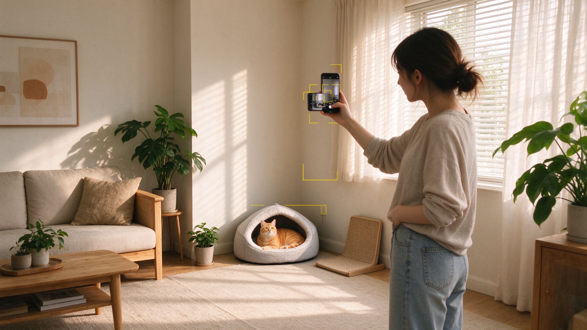
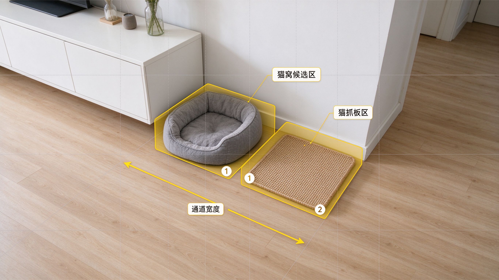
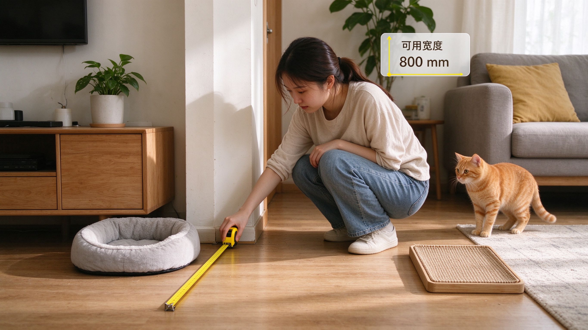
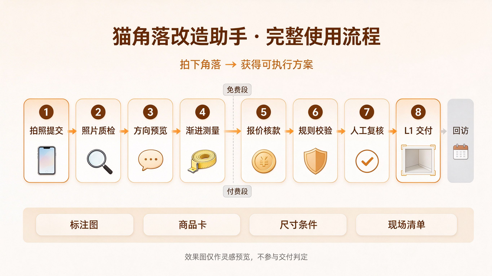

# 猫角落改造助手 · 项目思路与执行纲领

**本文是什么：**基于《猫角落改造助手 产品需求文档 v0\.4》（2026‑10‑19）提炼的项目纲领，回答两个问题——**为什么这么做（思路）**和**接下来要干什么（执行）**。

**一句话思路：**不赌市场。先用 V0 人工＋AI 验证服务跑通「愿意继续、愿意行动、愿意付费」三个层次，G1 四项门槛全部通过后，才启动 V1 小程序完整闭环开发。

**产品定义：**猫用品买前摆放检查 ＋ 角落改造辅助。用户拍下一个室内角落，先得到方向预览；有继续购买或摆放意图时，逐步确认关键尺寸，获得标注图、商品候选或复用建议、尺寸条件及现场确认清单。

# 产品是什么：用 STAR 法则说清楚

## S · 背景（Situation）

养猫家庭常见的痛点是「买前没有依据、摆放靠试错」：搬家或调整家具后，不知道哪个角落适合放猫用品；买了猫窝、猫抓板却放不下、猫不用；现有用品占道或刚买错，不知道怎么处理；预算有限，却不知道先改哪一项。公开可检索的同类工具稀少（是否真是市场空白，由验证期用户的实际对比对象补充确认），买猫用品基本靠目测和试错，导致反复购买、反复挪动。

## T · 任务（Task）

让用户拍下一个室内角落，就能得到有针对性的判断：这个角落**值不值得继续改造、下一步该量哪里**；有继续购买或摆放意图时，再逐步确认关键尺寸，最终获得尊重预算、保留物和空间条件的**可执行方案**——标注图、商品候选或复用建议、尺寸条件与现场确认清单。

## A · 行动（Action）

先以 V0 人工＋AI 验证服务落地完整旅程：提交照片与基础信息 → 照片质检 → 免费 L0 方向预览 → 每轮 1—2 项渐进测量 → 可承接确认与报价 → 核实到账 → 布局与规则校验 → 人工复核 → L1 交付 → 第 7/14 天回访。G1 四项门槛全部通过后，再开发 V1 小程序完整闭环。

产品形态示意（概念图，非真实产品截图）：

## R · 结果（Result）

对用户：减少无效购买与反复挪动，明确候选规格能否放下及阻断原因，允许不买新品、保留原状，在预算内排出优先级。对产品：用真实收款、行动与回访数据验证「买前检查是否值得付费」，再决定是否投入小程序开发，避免赌市场。

# 核心思路：先验证，再开发

## 为什么先做 V0 验证

市场、模型准确率与商业模式都**尚未成立**，因此不在 G1 之前投入完整小程序开发。V0 用人工与 AI 结合的验证服务，以最小成本验证三件事：

- **愿意继续**——用户是否愿意在收到 L0 方向预览后补齐关键尺寸；

- **愿意行动**——拿到 L1 后是否在 14 天内实际摆放、购买或复用；

- **愿意付费**——是否愿意为买前检查支付不低于 19\.9 元的服务费或预付款。

G1 门槛（10 名有真实意图的用户中至少 7 人继续、5 人行动、3 人付费，并满足同条件比较要求）是**立项门槛，不是统计推断**。

**V0 通过只证明「人工＋AI 验证服务」有人继续、行动、付费，不自动证明小程序自动化闭环成立。**验证期内逐环节记录人工介入点与耗时（对应 F12 台账），作为 MVP 设计期判断「哪些环节可自动化」的输入，避免把「服务有人买单」误读为「自动化产品成立」。

## 可靠性分级：不越级承诺

|等级|可提供的价值|准入条件|禁止行为|
|---|---|---|---|
|**L0 方向预览**|判断是否值得继续、知道下一步量哪里|可用照片、圈选、目标、预算、保留物|购买承诺、精确摆放结论、安装指引|
|**L1 可执行建议**|作为购买与地面摆放参考|全部必要尺寸、物品或 SKU 记录、规则通过、人工复核|保证安全、保证猫使用、代替现场确认|
|**L2 实地核验**|核对实际空间与方案是否相符|测试人员实测对照及记录|作为首版面向用户的普遍承诺|

默认交付标注图与商品卡，**不默认生成逼真效果图**；效果图永远单独标注为「灵感预览」，不参与 L1 通过判定。L1 中涉及尺寸、承重、固定、材料安全等关键未知，必须阻断对应候选，不能把未解决的关键风险塞进「现场确认」清单后继续推荐。

## 交付边界与关键口径

- 「先补 1—2 个尺寸」指**每轮提问上限**，不是总测量上限；缺少必要尺寸仍不能交付 L1。

- 新品必须有已核对 SKU；仅复用旧物时使用用户物品记录，**不强制购买或凑 SKU**。

- L0 不得给无依据的「可行」结论，只能使用「有条件继续 / 当前条件不支持 / 信息不足」。

- V0 在尺寸补齐、确认可承接并报价后**收款**，再制作 L1；交付后的打赏不算付费需求证据。

- 最小接单台账、复核、删除与费用开关为 P0；可视化运营后台为 V1 P1。

- V0 期间以人工复核为参考标准评估 AI 组件：记录 L0 方向通过率、照片质检误收／漏收率、尺寸推断误差上限；未达口径的环节保持人工兜底，不让「准确率未成立」停留在口头风险。

## 风险控制思路

|风险|必须采取的产品动作|
|---|---|
|L0 废话或假确定性|指出照片中的具体区域、一个行动和一项缺失信息；无依据时回到补拍|
|测量负担过重|每轮最多问 2 项，标明端点、单位和用途；用户可选择停止|
|效果图误导|从核心交付移除；标注图不按像素反推厘米|
|商品少且过期|允许空结果；缺关键字段停用；不生成虚构商品补位|
|人工成本失控|记录分阶段用时、重试费用和返工；按容量接单|
|低频和弱付费|用买前检查触发验证；分别记录行为和收入|
|免责声明替代检查|关键风险阻断，复核失败不能发布 L1|

# 要干的事情：V0 执行蓝图

## V0 服务旅程

流程要点：L0 段免费、只判断是否值得继续；L1 段在报价并核实到账后执行。任何一步关键尺寸缺失、规则硬阻断或人工复核未通过，都不能发布 L1；无法承接时结束任务且不收款。

## 阶段计划与退出条件

|阶段|工作及产出|退出条件|
|---|---|---|
|**验证期**|两周接单执行＋末次交付后 14 天回访；10 案、30 张授权照片试验、成本台账|G1 四项通过，承接与数据条件可实现|
|**MVP 设计期**|页面原型、测量卡、10—15 个 SKU、规则表、字段与状态、隐私和预算配置|关键阈值与 TBD 已确认，可评审验收|
|**开发期**|上传预览、测量、规则、标注、人工发布、私密存储、最小工作台|F1—F12 对应 P0 能力可联调|
|**测试期**|30 例独立样本、5 角落实测、故障及隐私测试、10—20 人封闭试用|AC01—12 及严重缺陷门槛通过|
|**冷启动期**|20—30 名用户限量开放，实测付费、商品承接与渠道数据|G2 完整通过后再讨论扩量|
|**迭代期**|修复失败、降低人工、商品巡检；新场景独立试验|旧问题回归通过且新场景有独立证据|

资源假设：产品兼运营 1 人、工程负责人 1 人，设计、QA 与专业审核按任务参与；发布复核和异常处理必须有明确责任人。开发排期在 G1 后估算，不承诺固定上线日期。

## P0 功能与验收（F1—F12）

|功能|核心要点|关键验收|
|---|---|---|
|F1 提交与授权|一张完整角落照片＋基础字段；服务授权与案例授权分离，案例授权默认关闭|AC01 拒绝案例授权仍可提交；未同意必要处理不上传|
|F2 照片质检|识别过暗、模糊、遮挡、缺地面边界、无关照片；返回原因和补拍示意，最多连续自动补拍 2 轮|AC02 5 人可用性测试至少 4 人一次提醒内提交可用照片|
|F3 L0 方向预览|1—3 个有根据的方向、可行动结论、一项风险或缺失项、继续需要的第一批尺寸；固定免责提示|AC03 每个合格 L0 都有具体区域、行动、风险或缺失项和继续条件|
|F4 方案修改与用户控制|锁定为硬约束；撤销恢复上一个版本；付费含一次 7 天内同角落同目标修改|AC04 锁定对象不被改动；新候选复核前不能标 L1|
|F5 渐进式测量|每轮 1—2 项；毫米存储、厘米输入显式换算；禁止像素反推；照片推断不能自动转实测|AC05 缺关键尺寸拒绝发布 L1|
|F6 商品候选库|新品先入人工核对表；V1 初始 10—15 个 SKU；商品不足允许空结果或复用|AC06 库外 ID 被拦截；空结果不触发虚构商品|
|F7 规则校验|硬阻断 / 提醒 / 未知三分类；先规则筛布局再匹配 SKU 再精确规格复检|AC07 超预算、遮挡保留物、关键未知案例均不能发布 L1|
|F8 默认交付与降级|标注图＋商品/复用卡＋尺寸条件＋现场确认清单；效果图仅作灵感预览且不影响核心交付|AC08 图中编号与清单一一对应；严重图单不符不得发布|
|F9 人工复核|复核清单逐项检查；记录复核人、有效分钟、规则与 SKU 版本；通过才发布|AC09 每单可追溯复核人；未复核、规则失败或版本变动拒绝发布|
|F10 分享、隐私与删除|V0 无分享功能；V1 分享需预览确认；默认分享脱敏；删除后立即关闭访问|AC10 跨账号访问拒绝；默认分享不泄露家庭图像|
|F11 回访与行为分层|第 7、14 天回访；使用、行动等独立记录为是/否/未知，失访单列|AC11 同一人同一门槛只计一次；行动与意愿字段不能混填|
|F12 最小工作台|V0 表格台账含任务、版本、等级、付款退款、复核、人工分钟、成本、失败原因、回访|AC12 超量能排队或停止；有严重事件可暂停发布及新收单|

## 运营配套与容量

- 每日容量按可用复核分钟 ÷ 最近有效单中位人工分钟估算，并由运营下调留返工余量；**未实测时先限每天 3 单**。

- 费用上限、积压阈值、值班人未填，**不得开放收费接单**。

- 重复请求不重复收费；收款后发现无法交付时关闭订单、说明原因并按约定退款。

# 验证门槛与决策闸门

## G1 立项闸门：是否开发小程序

|层次|门槛|证据要求|
|---|---|---|
|**愿意继续**|至少 7 名在一次提醒内补齐关键尺寸|已确认实测记录；额外必要尺寸也须补齐|
|**愿意行动**|至少 5 名在 L1 交付 14 天内实施建议|具体行动、日期与对应建议；口头「准备做」不算|
|**愿意付费**|至少 3 名支付不低于 19\.9 元服务费或预付款|到账核验、订单、退款状态；非补贴或打赏|
|**相对价值**|至少 5 例同条件比较，至少 3 例有明确优势|同一空间与预算；记录原办法、耗时、错误或采纳理由|

G1 未通过时最多进行一次针对主因的复验（新一批符合条件用户，保留原结果）；再失败则暂停开发。19\.9 元是验证价格下限而非最终定价；支付后全部退款不计付费门槛成功，退款在途暂不判成功。

### 操作口径：让门槛可执行

- **真实意图用户**：通过自然或付费渠道招募并记录来源，排除测试人员、亲友及事先知晓验证安排的人员；意图以「补齐关键尺寸、实际支付」等行为判定，不以问卷或口头承诺为准。

- **同条件比较**：同一用户、同一角落、同一预算下，将 L1 建议与用户原办法（目测／经验／其它工具）对比；记录原办法、耗时、错误或采纳理由。

- **19\.9 元定价依据**：按单次 L1 交付成本底线（人工分钟＋模型与存储费用）推演，保证覆盖成本并留出毛利，同时高于打赏阈值以筛除「顺水人情」式付费；V0 收图前完成成本底线测算，测算高于 19\.9 元时提价或限缩交付范围。

## G2 扩量门槛

30 例与调优集分离的限定场景样本，至少 27 例在约定调用上限与交付时限内合格交付，已交付严重安全或尺寸冲突为 0；允许人工但须单列人工分钟。人工分钟、每交付成本、获客费用应低于预先批准上限，渠道转化应达到批准下限——**负责人必须在试验前填入具体数值**，未填不能判 G2 通过。30 例只用于控制投入与找问题，不是总体准确率证明。

## 停止条件与成本核算

- G2 不通过：保持小量服务或收缩承诺；人工无法降低则评估咨询服务，不能靠无限免费调用扩量。

- 每合格交付成本＝本批全部模型费（含 L0、失败、重试）＋全部人工费＋存储支持费，除以合格交付数。

- 净贡献＝实收 − 退款 − 渠道手续费 − 变动交付成本 − 获客成本；固定开发成本另列，不把 GMV 或未结算佣金当收入。

# 上线前必须确认的配置

以下配置均须**记录批准日期及版本**，不得留空后由模型自行补值：

- 实际责任人、服务工作日与时限；

- 原图和第三方保留规则（默认：未继续的 L0 图最后活动 7 天后清除，L1 任务交付 30 天后清除家庭图像）；

- 品类安全与余量阈值（通道、余量阈值由审核后的规则表维护，不臆造统一安全数值）；

- 单任务及每日费用限额、人工分钟上限、单位成本上限、渠道转化下限；

- 收款及退款路径（V0 收图及收费前核查工具处理条件与收费承接）。

- 合规基线：家庭图像属个人信息，遵循告知\-同意与最小必要原则，支持撤回同意并限期删除（与 F1 授权分离、F10 删除规则一致）。

# 开放问题：验证而非提前下结论

|问题|验证方式|负责人与决策时点|
|---|---|---|
|L0 是否足够有用，用户愿否测量|记录继续及补全行为、拒绝原因|产品；G1 前|
|标注图与商品卡是否足够|默认不用效果图交付，回访行动障碍|产品；G1 及冷启动|
|买前检查愿付多少钱|统一范围的真实收费试验；退款分列|运营；G1 及迭代|
|自然获客是否可承担|人工工时计入渠道成本；看净贡献而非客单|运营；G2 前|
|人工审核能否降低|分阶段计时及返工归因|工程与产品；G2 前|
|商品承接与数据处理是否可用|核查工具条件并真机测试|工程及合规；收图收费和上线前|
|猫使用反馈是否可收集|第 7 及 14 天自愿回访，失访单列|运营；每批复盘|

**补充待验证项**：三层行为（继续／行动／付费）的交叉与转化——继续但未行动、行动但未付费的用户特征与原因，用于判断漏斗在哪一层流失；由产品与运营在 G1 复盘时产出。

# 执行重点

## 最关键的 5 件事

1. 用真实收款和退款记录验证有人愿意为「少买错」付费，不以点赞或打赏替代。

2. 守住 L0 和 L1：关键尺寸、规则和人工复核缺一项都不能发布 L1。

3. 每轮只问 1—2 个关键尺寸，但不牺牲必要信息；用户可以停在 L0。

4. 默认标注图、商品或复用卡、尺寸条件及现场清单；效果图不参与可执行交付。

5. 计入人工、免费预览、失败重试、获客和退款，依据净贡献决定是否扩量。

## 可以暂缓的 5 件事

1. 逼真效果图和完美 SKU 渲染。

2. G1 前的完整小程序，以及自建商城。

3. 大商品库、全网采集和复杂 Agent。

4. 社区、积分、订阅与分享增长。

5. 猫砂食水整体布局、高位、阳台、墙面及复杂多猫方案。

需求 F1—F12 对应验收 AC01—AC12，均待执行。范围、门槛和费用变更须记录批准人及原因，不得事后改分母证明成功。G1 未通过，不进入 V1 完整开发。

> （注：部分内容由豆包工作 AI 生成）
